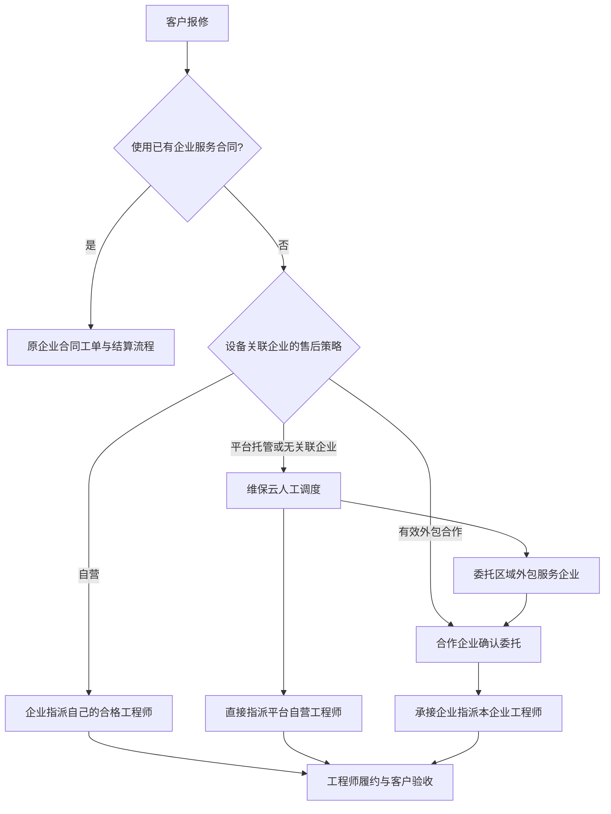

# 售后组织、委托与工程师任务：首轮交付

## 业务关系

维保云平台运营账号负责企业治理、培训审核、委托与调度。平台自营技术服务中心是一个独立 SaaS 企业，只能管理自己的人员和业务，不具有平台管理员权限。

三种团队分别是设备企业自有团队、合作外包服务企业、平台自营服务企业。工程师使用统一手机号账号；任务上的履约企业决定本次工作身份，与个人中心当前选中的工作空间分开。

合作关系与单次任务是两个独立确认：先确认企业合作，之后每张外包服务单仍需承接企业接受。设置外包方式前必须存在有效合作；城市、服务类别和工程师有效资质共同限制可派范围。无法覆盖时明确报错，不会偷偷换成其他承接方。

## 四端入口

| 端 | 入口与操作 |
| --- | --- |
| 维保云 3103 | 首页“售后组织与委托”：登记组织类型、城市与售后策略，发合作邀请，向企业发委托、查看确认和撤回。原“服务市场与培训”继续做工程师审核、培训及平台直接派人。 |
| 企业后台 3100 | “平台服务协作”：本企业售后策略、合作邀请、接受/拒绝委托、指派本企业已审核的工程师、查看关联订单和服务项目。 |
| 工程师端 3102 / 手机 4102 | 统一工单列表增加团队筛选；卡片与详情显示团队类别、履约企业和派单来源。原企业具体工单及其用料入口按本单企业绑定，切换个人工作空间不会改变工单归属。 |
| 客户端 3101 / 手机 4101 | 设备卡显示自营/外包/平台安排；报修页读取设备企业策略；订单详情显示实际承接方、调度方式与设备关联企业。 |

平台直派外包企业员工不能绕过企业承接确认。任务已指派后，当前版本不允许通过撤回企业委托更换承接方；已有履约继续留存。

## 保留的演示数据

| 组织 | 企业登录账号 | 工程师手机号 |
| --- | --- | --- |
| 维保云自营技术服务中心（演示） | weibao_service_demo | 13690000101（陈工）、13690000102（周工） |
| 华南激光售后服务有限公司（演示） | huanan_service_demo | 13690000201（刘工）、13690000202（黄工） |

企业后台初始密码在维保云企业详情中查看，也记录于本机 `.local-preview/service-network-demo.json`，未硬编码进前端。

客户端演示手机号：**13897000101**。手机端演示验证码 **000000**。工程师资质明确标注“模拟培训考核（仅演示）”，不代表真实人员、真实培训或证书。

- 华东激光：自有售后团队。
- 绍辉：与华南建立了已确认合作，覆盖深圳市、东莞市、广州市；关联设备的新服务单按外包方式安排。
- 5 条演示订单覆盖平台直派自营工程师、平台委托外包待接单、外包人员服务中、绍辉设备外包、华东设备自营。

新增平台散修工程师时，由自营服务中心管理员在“工程师管理”建立员工账号，再由该工程师提交接单资料、报名培训，维保云审核与考核通过后安排任务。外包企业用同样方式管理自己的员工。新员工默认使用已有企业工作身份申请。

可按以下顺序体验：维保云查看区域外包演示单 → 用华南企业账号接受委托并派刘工/黄工 → 工程师登录确认任务、报价及完工 → 客户端登录确认报价和验收。

## 验证及边界

`backend/test/service-network.mjs` 验证四端实际页面、完整履约链路、自营/外包设备路由、区域限制、未确认委托不能抢单、跨企业查看/接单/派人被拒绝。原 `service-market.mjs` 和 `mobile-workspaces.mjs` 保留市场、企业隔离、合同、图片与移动端回归。

本轮新增的是可演示的组织与委托业务，不是电子签约、企业间自动分账结算或自动最优派单。无设备关联企业的需求由平台人工决定交给自营还是区域外包团队。

原有及新提交的“使用企业服务合同”工单，仍按原企业合同流程受理和结算，不自动转成平台外包服务单。本轮外包路由适用于不使用原合同的新服务单；已有工单未批量迁移。

市场服务单没有被复制成承接企业的原合同工单。企业移动仓仍按现有企业库存流程操作，本轮没有增加跨企业自动扣库或结算。

重复执行 `node scripts/seed-service-network.mjs`、`node scripts/seed-service-orders.mjs` 不会重复创建相同演示企业、人员与样例服务单。测试产生的临时订单和客户会清理，演示数据保留。
